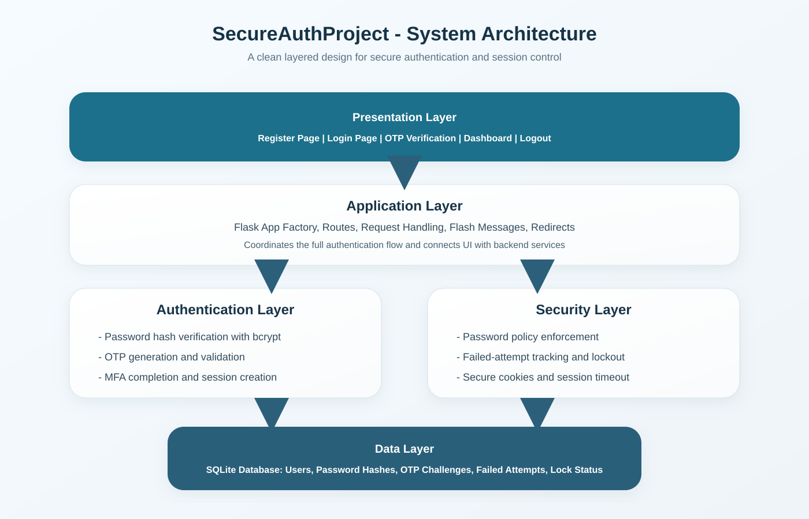
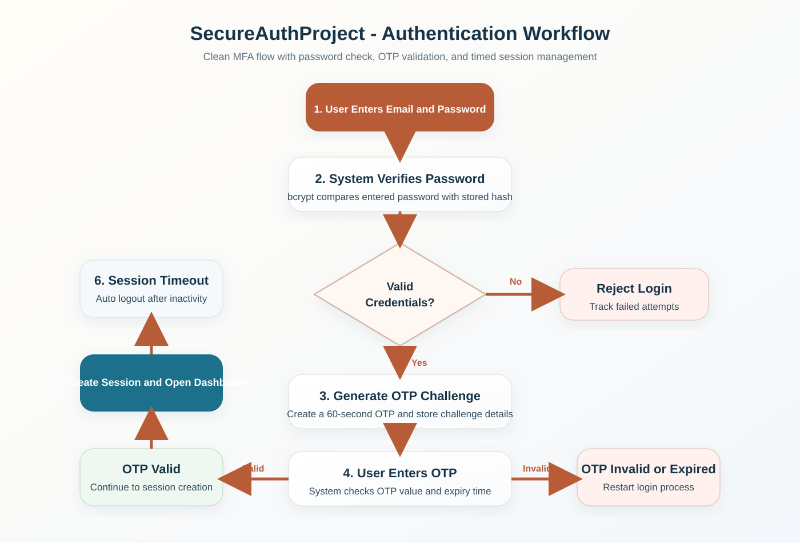

# Secure Password & Authentication System

A Flask web app that hardens the login flow against common credential attacks: brute force, credential stuffing, offline dictionary and rainbow-table cracking, OTP replay, and session hijacking.

Built for COSC-3796 (Info Tech Security & Privacy) at Algoma University.

   

## Why

The 2012 LinkedIn breach exposed millions of passwords stored as unsalted SHA-1 hashes, which are fast to crack. This project shows what a layered alternative looks like: slow salted hashing, a strict password policy, a second factor, lockouts and short-lived sessions.

## Security features

| Feature | Implementation | Defends against |
|---|---|---|
| Strong password policy | 10+ chars with upper, lower, digit and special char, enforced client-side and server-side | Weak and guessable passwords |
| Password storage | bcrypt with a per-user random salt; plaintext is never stored | Offline dictionary and rainbow-table attacks |
| Multi-factor authentication | 6-digit OTP from `secrets`, stored only as a bcrypt hash, expires in 60 s | Stolen passwords, replay |
| One live OTP per user | Old challenges are deleted before a new one is issued | OTP reuse |
| Account lockout | 5 failed attempts locks the account for 5 minutes | Online brute force |
| Session security | HttpOnly + SameSite=Lax cookies, 7-minute lifetime, separate pending-MFA and authenticated session states | Session hijacking, partial-auth abuse |
| Parameterized SQL | All queries use bound parameters | SQL injection (covered by tests) |
| Generic error messages | Same message for unknown email and wrong password | User enumeration |

## Architecture



```
app.py                  entry point
secureauth/
  __init__.py           app factory
  config.py             security settings (policy regex, OTP expiry, lockout)
  routes.py             register, login, verify-otp, dashboard, logout
  security.py           validation, bcrypt hashing, OTP generation
  db.py                 SQLite connection and schema
app/templates/          Jinja2 pages
app/static/             CSS, password policy + show/hide JS
test_auth.py            auth, lockout, OTP and session tests
test_sqli.py            SQL injection tests
```

## Authentication flow



1. User registers; the password is checked against the policy, then bcrypt-hashed.
2. User logs in with email and password. Failures increment a counter; 5 in a row triggers a lock.
3. On a correct password, an OTP challenge is created and the session moves to a *pending MFA* state.
4. A correct OTP within 60 seconds promotes the session to fully authenticated. A wrong or expired OTP sends the user back to login.

## Run it locally

```bash
python -m venv .venv
# Windows
.venv\Scripts\activate
# macOS / Linux
source .venv/bin/activate

pip install -r requirements.txt
python app.py
```

Open http://127.0.0.1:5000. After logging in, the OTP is printed in the terminal as `[DEMO OTP] ...` (demo mode, see Limitations).

Optional environment variables:

| Variable | Purpose |
|---|---|
| `SECRET_KEY` | Flask session signing key. Set a long random value outside local dev. |
| `FLASK_SECURE_COOKIE=1` | Send the session cookie over HTTPS only. |

## Tests

```bash
pip install -r requirements-dev.txt
pytest -q
```

24 tests cover registration and password policy, login and lockout, lockout reset, wrong-OTP handling, OTP routes without a pending session, protected routes, logout, and SQL injection payloads against both login and registration.

## Limitations and next steps

- **OTP delivery:** OTPs are printed to the server console for the demo. Next step is email delivery (SMTP/SendGrid) or a TOTP authenticator app.
- **CSRF:** Forms have no CSRF tokens yet. Planned: Flask-WTF `CSRFProtect`.
- **HTTPS:** Secure cookies are opt-in via env var. Production would run behind TLS with them always on.
- **Scale:** SQLite and the Flask dev server are fine for a prototype, not for production traffic.
- **Missing features:** password reset, email verification and audit logging.

## Team

Dhruv Panchani, Hemil Patel, Parthil Lathiya

## References

- OWASP Authentication Cheat Sheet
- NIST SP 800-63, Digital Identity Guidelines
- Provos & Mazieres (1999), *A Future-Adaptable Password Scheme* (bcrypt)
